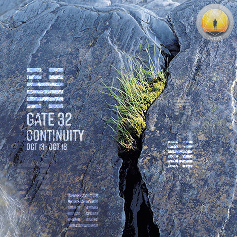
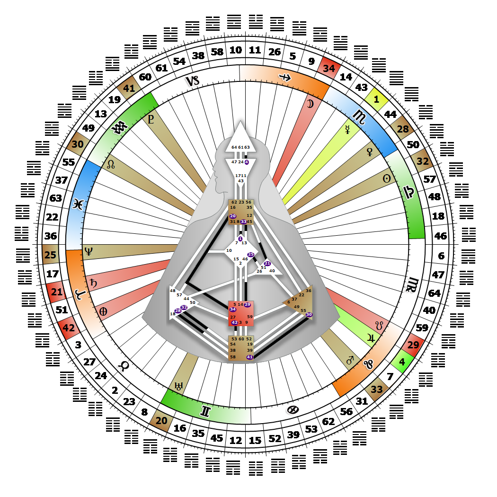

# [翻译失败] Gate 32 - Duration

**2026年10月14日**

## *[翻译失败] Gate of Continuity - Conservatism*

> [翻译失败] The only thing which endures is change. The instinct to adapt in the now, without losing continuity, while maintaining our basic nature.

### [翻译失败] Right Angle Cross of the Maya 3 | Godhead - Minerva

*[翻译失败] Quarter of Duality,  the Realm of JupiterTheme: Purpose fulfilled through BondingMystical Theme: Measure for Measure*

---

[翻译失败] This Gate is part of the Channel of Transformation, A Design of Being Driven, linking the Splenic Center (Gate 32) to the Root center (Gate 54). Gate 32 is part of the Tribal (Ego) Circuit with the keynote of support.

Awareness through Gate 32 is focused on constant evaluation as an instinctive recognition of what can and cannot be transformed. An underlying fear of failure can put the brakes on runaway ambition. Gate 32's ability to adapt, yet maintain its true nature, is the Spleen's contribution to the material continuity of the Tribe. This is part of our contribution as well. A great deal rests on what is recognized and valued, and thereby encouraged and retained by the Tribe. One of our gifts is recognizing who has the skills or education to move up in the world; and then, using our influence, to bring them to the attention of those in positions of authority.

This is the gate of prolonged indecision. We are apt to find ourselves agonizing over how to maintain a balance between what is working successfully (conservatism), and opening ourselves or an organization up to the unknown risks (fear of failure) that accompany transformation and change. Change is inevitable, however, and when it becomes part of the equation for life, growth is optimized. By relying on our Authority for timing, and staying closely attuned to our own instincts, our wisdom will emerge over time as ways to keep society from repeating what does not work, while also embracing what has lasting value. Without Gate 54 the 32nd gate senses its lack of a consistent source of fuel or drive or ambition to succeed.

---

### [翻译失败] Line 1 - Conservation

**☀️ 高階表達:** [翻译失败] A life sustaining respect and attention to all aspects of a process. The potential to develop the instinct through detailed attention to a process.

**🌑 低階表達:** [翻译失败] The uncontrollable urge to bypass essentials which inevitably leads to the disruption of continuity. The fear of lack of potential, and the corresponding lack of attention.
