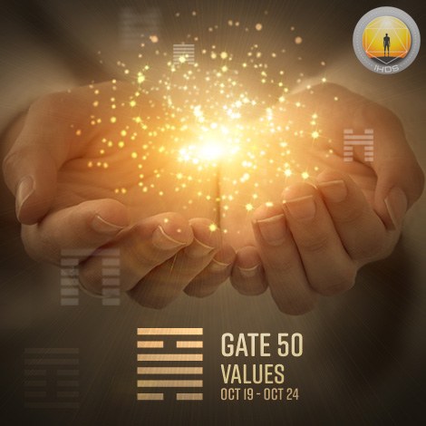
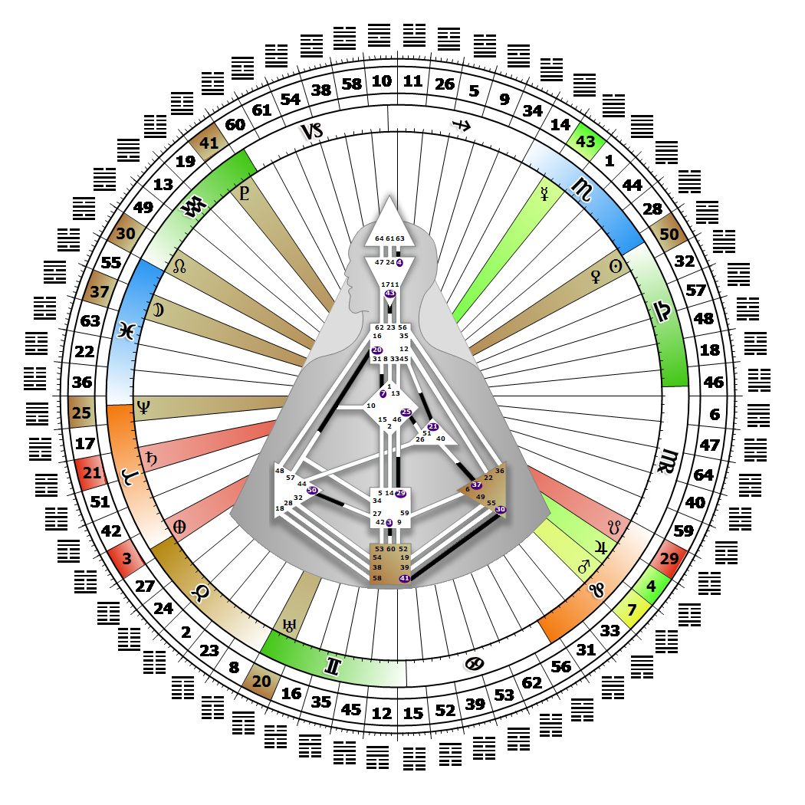

# Gate 50 - The Cauldron

**October 22, 2026**

## *Gate of Values - Guarding and Maintaining the Tribe*

> The value of historical continuity whose traditional values serve and enrich the present and future. Establishing the rules and laws of caring.

### Right Angle Cross of Laws 3 | Godhead - Minerva

*Quarter of Duality,  the Realm of JupiterTheme: Purpose fulfilled through BondingMystical Theme: Measure for Measure*

---

This Gate is part of the Channel of Preservation, A Design of Custodianship, linking the Splenic Center (Gate 50) with the Sacral Center (Gate 27). Gate 50 is part of the Tribal (Defense) Circuit with the keynote of support.

Each act of intimacy that results in a birth demands that the offspring of the union be nurtured into adulthood. Gate 50's mystical name is the Guardian. As the Tribal lawmaker, it establishes what is right or wrong. This is how and where the rules for caring become the source of moral conditioning for our children. At the core of the Tribe's defenses lies the Spleen's fear-driven mandate to maintain its own viability by protecting and guiding its young. We are here to guard the values and integrity of Tribal law, and the structures that uphold the well-being of the community. Our task is to be cognizant of which values or laws or rules safeguard how the Tribe cares for its own. Our instinctual awareness scrutinizes which are corrupt or unjust, unnecessary or self-serving, or need to be challenged and changed. This is our way of caring for and nurturing every aspect of life within the Tribe.

Without Gate 27 we may try to physically take care of others when it is not correct for us to do so, thus fulfilling our fear of taking on responsibility that we aren't equipped to handle.

---

### Line 3 - Adaptability

**☀️ Exaltation:** The Moon exalted, that when unable to make it alone will naturally align itself with nurturing and protective forces. The awareness that to maintain one's principles and values the support of others is necessary.

**🌑 Detriment:** A resentment when its natural mental gifts are ignored and is forced to curry favour in order to survive. Discomfort with the awareness that one cannot stand alone by one's principles.
