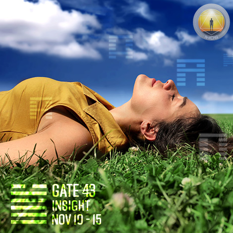
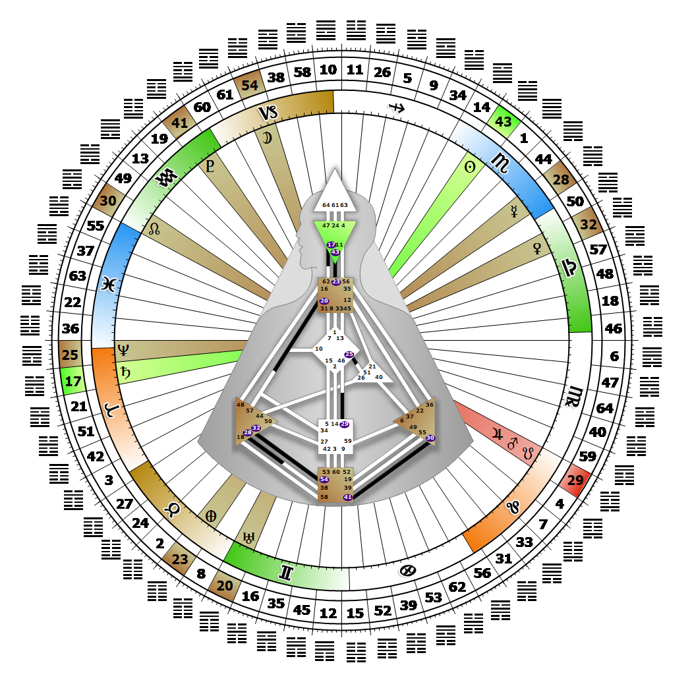

# [翻译失败] Gate 43 - Breakthrough

**2026年11月14日**

## *[翻译失败] Gate of Insight - Listen to Your Own Inner Voice*

> [翻译失败] In order for achievement to be maintained a new order must be fairly established. Expressing and transforming inner truth into a unique perspective.

### [翻译失败] Right Angle Cross of Explanation 4, Juxtaposition Cross of Insight | Godhead - Hades

*[翻译失败] Quarter of Mutation,  the Realm of SiriusTheme: Purpose fulfilled through TransformationMystical Theme: Accepting Death*

---

[翻译失败] This Gate is part of the Channel of Structuring, A Design of Individuality (Genius to Freak), linking the Ajna Center (Gate 43) with the Throat Center (Gate 23). Gate 43 is part of the Individual (Knowing) Circuit with the keynote of empowerment.

Gate 43 is the gate of the inner ear and only listens to its own unique inner voice. It can spontaneously transform rational inner knowing into Individual insight and new perspectives. Our knowing is not backed up by facts, however, and it can take fortitude to stand behind and explain insights that seem freakish and completely outside of the Collective or Tribal norms. We have the capacity, when the timing is right, to mentally mold a unique and mutative awareness into its final shape. When fully conceptualized, our insights need to be invited in order to bring the potential mutation, the possibility of a new perspective, out into the world. Nothing is more difficult for us than to listen to and really hear others. It's not our fault, nor a problem to be fixed, but simply our genetic protection from undue influence. Gate 43 carries a fear of rejection.

Without Gate 23, we may wonder how to clearly communicate our breakthrough insights. Mental anxiety arises when we fear that our ideas are too weird, and if we can't explain them we are vulnerable to the possibility of their being rejected.

---

### [翻译失败] Line 4 - The one-track mind

**☀️ 高階表達:** [翻译失败] The overreliance and stubborn obsession with one's mental abilities in the face of recurring obstacles. This design, given Mercurial mental gifts, may though rarely succeed. A stubborn reliance on one's unique insights that demands focused mental ability to be properly conceptualized.

**🌑 低階表達:** [翻译失败] A belief in inherent right action based on limited knowledge that shuns advice. The vanity to attempt expression without depth.
