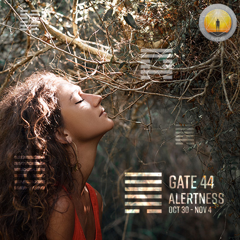
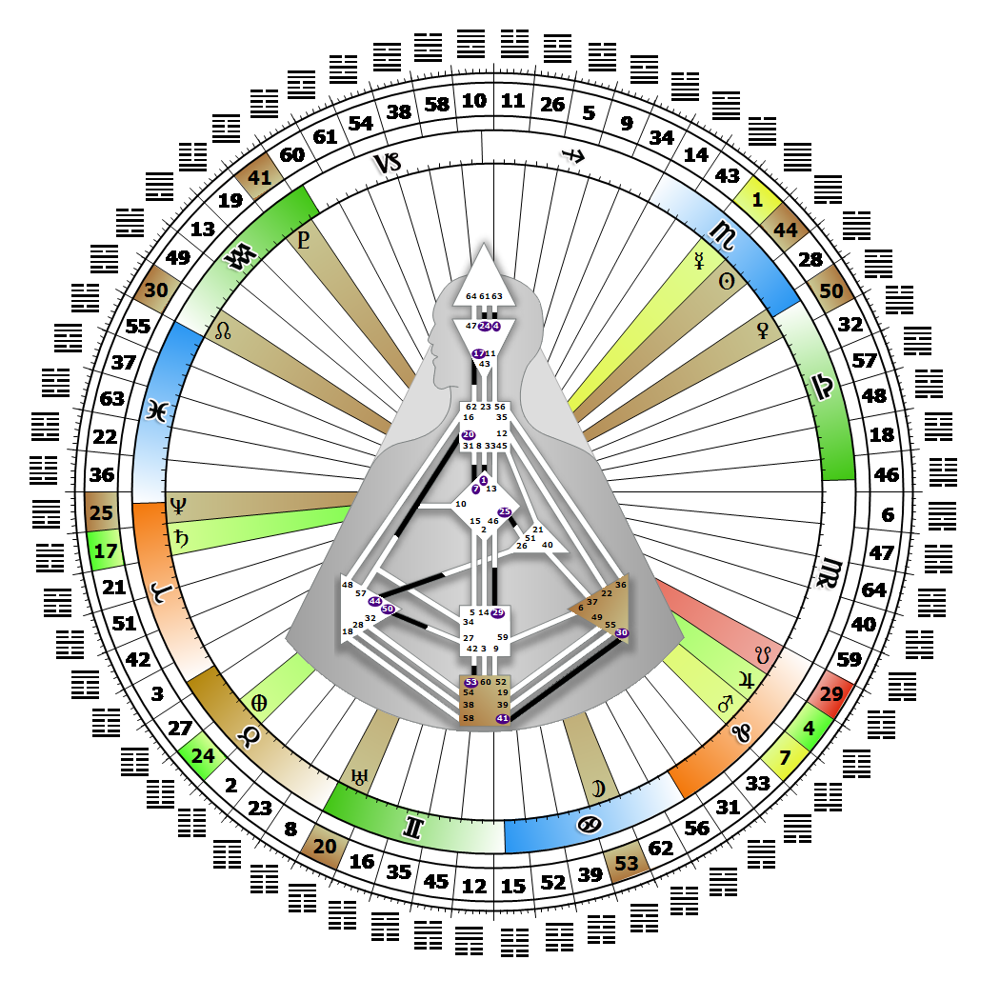

# Gate 44 - Coming to Meet

**October 31, 2026**

## *Gate of Alertness - The Personnel Manager*

> The success of any interaction is based on the absence of any preconditions. Instinctive memory and alertness that can manage and mold the collective.

### Right Angle Cross of the Four Ways 3 | Godhead - Minerva

*Quarter of Duality,  the Realm of JupiterTheme: Purpose fulfilled through BondingMystical Theme: Measure for Measure*

---

This Gate is part of the Channel of Surrender, A Design of a Transmitter, linking the Splenic Center (Gate 44) with the Ego Center (Gate 26). Gate 44 is part of the Tribal (Ego) Circuit with the keynote of support.

Gate 44 is the gate of memory; it remembers the patterns for living that have successfully provided for our material needs. This memory is an integral and consistently trustworthy part of our survival intelligence as a species. We are instinctually alert in every moment for the correct spontaneous relationship or interaction that can move a potential to the level of a possibility. What we remember or transmit shapes the Tribes' material orientation, and eventually strengthens its ego presence and power in the world. We control the way Gate 26 is going to act in terms of selling, defending or fighting for the tribe. This is where tribal propaganda can be found. We help the Tribe to allay its fears of the past by remembering that a starving child is not a healthy child, and that material security and health go hand in hand. The Spleen is not a motor, so once our awareness is recognized and valued by the Tribe, we will look to the willpower of Gate 26 to act on it. In this way, whatever transformation we instinctively know the Tribe needs to ensure its survival becomes a reality.

Without Gate 26 we are prone to unnecessarily exaggerate by over-committing and making promises we cannot keep. What we fear most is that baggage from the past might catch up with us.

---

### Line 1 - Conditions

**☀️ Exaltation:** A mastery of the collective that can establish restrictive conditions for inferior components and with the ability to enforce them. An alertness to patterns than can lead to mastery of the collective.

**🌑 Detriment:** An attractive nature that will interact with inferior forces and will fail to apply restrictions resulting in a risk to continued harmony. The failure of the instinct out of the need for harmony.
