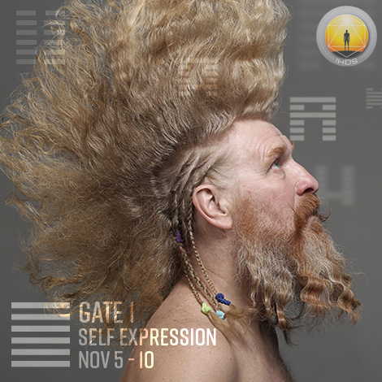
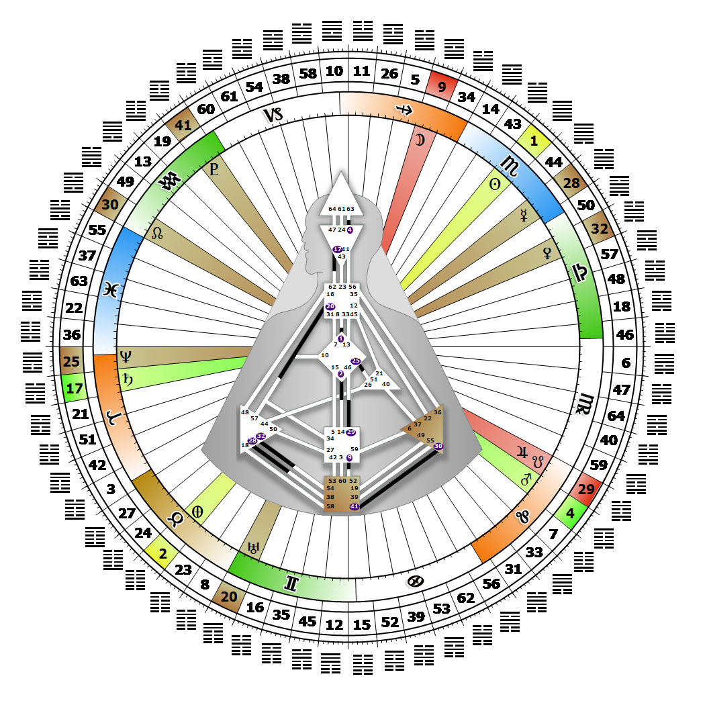

# [翻译失败] Gate 1 - The Creative

**2026年11月06日**

## *[翻译失败] Gate of Self-Expression - Creativity Rooted in Unique Direction*

> [翻译失败] Creativity as a primal force. The energy potential to manifest inspiration with out limitation. Individual expression fulfilled through interaction.

### [翻译失败] Right Angle Cross of the Sphinx 4 | Godhead - Hades

*[翻译失败] Quarter of Mutation,  the Realm of SiriusTheme: Purpose fulfilled through TransformationMystical Theme: Accepting Death*

---

[翻译失败] This Gate is part of the Channel of Inspiration, A Design of being a Creative Role Model, linking the G Center (Gate 1) to the Throat Center (Gate 8). Gate 1 is part of the Individual (Knowing) Circuit with the keynote of empowerment.

Gate 1 is the drive and deep need to focus on expressing oneself in unique and creative ways. Those that carry this gate are not concerned with being the best, which is a comparative trait of the Collective. We simply want to live out our true creative nature, our authentic individuality. When happily absorbed in doing "our own thing," we are not aware that we are attracting the attention of others. It is while we are being true to our creative process that what we are doing, and how we are doing it, has its greatest impact. As we exemplify new ways of expressing our authentic self, we empower others to consider new perspectives or new ways of being in the world. We may even change our creative direction. Creativity inspires others by example, and for impact to be properly felt and appreciated, it must be seen or heard. This requires interaction with the world.

Without Gate 8 in our design, what we probably find least attractive is marketing our own work. We will often find ourselves drawn to people with Gate 8 because they are better equipped, or in a better position, to promote our work for us.

---

### [翻译失败] Line 2 - Love is light

**☀️ 高階表達:** [翻译失败] Venus exalted as a symbol of beauty. The required harmony between established values and ideals that enriches inspiration. Self-expression conditioned by ideals and values.

**🌑 低階表達:** [翻译失败] Desires and passions have their place but not at the expense of Creation. Self-expression limited by desires and passions.
