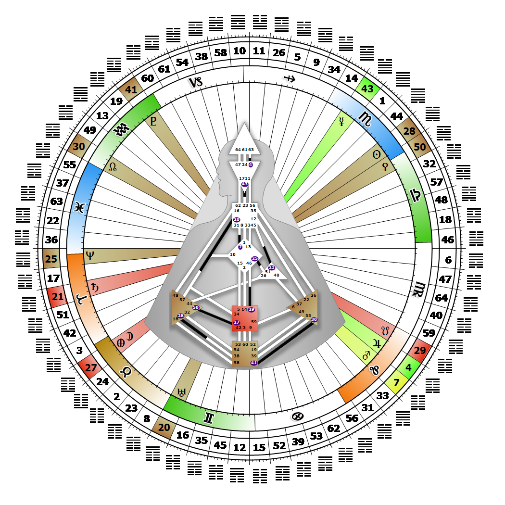

# [翻译失败] Gate 28 - Preponderance of the Great

**2026年10月29日**

## *[翻译失败] Gate of the Game Player - The Challenge is Life Itself*

> [翻译失败] The transitoriness of power and influence. The potential of intuition is to know in the now whether it is of value to struggle or not.

### [翻译失败] Left Angle Cross of Alignment 2 | Godhead - Minerva

*[翻译失败] Quarter of Duality,  the Realm of JupiterTheme: Purpose fulfilled through BondingMystical Theme: Measure for Measure*

---

[翻译失败] This Gate is part of the Channel of Struggle, A Design of Stubbornness, linking the Splenic Center (Gate 28) to the Root Center (Gate 38). Gate 28 is part of the Individual (Knowing) Circuit with the keynote of empowerment.

Gate 28's deepest fear is that life might end before one knows what makes it worth living, or what gives it meaning. It's an energy that is stubbornly focused on listening with awareness in order to best intuit which risks will make us feel more alive, and lead to struggles which bring purpose to existence. With our Splenic awareness constantly alerting us to danger, we are willing to take risks others wouldn't, to play games with life and death. Ultimately, we will spontaneously meet and confront our own fears of death one at a time. Those who carry this gate have the energy needed to redirect the self-absorbed nature of people with Channel 57-20 by prodding them to make their intuitive knowing available to themselves and to others.

Our own awareness helps people with Gate 38 determine who or what they should invest their energy in, enabling them to better assess the health and safety factors for whatever they consider worth fighting for. Without Gate 38, we may fall victim to unnecessary pressure to fight or struggle, experiencing needless resistance and exhaustion. We look to people with Gate 38 for clues about what they have discovered makes their life's struggles worthwhile.

---

### [翻译失败] Line 5 - Treachery

**☀️ 高階表達:** [翻译失败] The manipulation of the collective, that while pitting one faction against the other, does not directly support or reject either. The intuitive capacity of the game player to provoke struggle amongst others.

**🌑 低階表達:** [翻译失败] The breaking of alliances with trusted forces to align with more powerful forces and its attendant destabilization of the whole. The intuitive recognition in times of struggle to know when alliances must be broken and its destabilizing effect on others.
